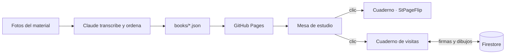
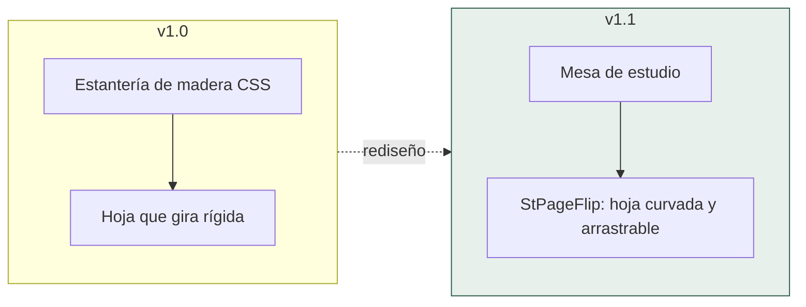

# 📚 Mi Biblioteca de Cuadernos

Una web con forma de **mesa de estudio**: cada curso es un **cuaderno** dejado sobre la mesa. Al tocarlo se abre, y las hojas **se curvan al pasarlas**, como papel de verdad. Hasta puedes arrastrar la esquina con el dedo o el mouse. Dentro van apuntes, listas, fotos del material y notas adhesivas.

En la mesa también hay un **cuaderno de visitas** de hojas blancas, con su bolígrafo al lado: cualquiera que entre puede **dibujar, escribir y firmar** en una hoja nueva.

No hace falta compilar nada: es HTML, CSS y JavaScript puro, así que funciona directamente en GitHub Pages.

---

## Cómo se usa

| Acción | Escritorio | Celular |
|---|---|---|
| Abrir un cuaderno | Clic en la tapa | Toque en la tapa |
| Pasar la hoja | **Arrastrar la esquina**, clic en la página o flechas → ← | **Arrastrar la esquina**, deslizar o tocar la página |
| Ir a la portada / al final | `Inicio` / `Fin` | Botones ‹ › |
| Ver una imagen en grande | Clic en la imagen | Toque |
| Levantar un dibujo (post-it) y leer lo de debajo | Clic en el post-it (otra vez para bajarlo) · lupa para ampliar | Toque |
| Volver a la mesa | `Esc` o **Biblioteca** | Botón ← |
| Ir al índice | Botón **Índice** (arriba) · tocar un tema del índice lleva a su página | Igual |
| Descargar en PDF | Botón **PDF** → en el diálogo de impresión, *Guardar como PDF* | Igual (Android: *Guardar como PDF*; iPhone: *Compartir* → *Guardar en Archivos*) |
| Firmar el cuaderno de visitas | **Firmar** (arriba) o **Firmar en esta hoja** | Igual |

Al acercar el mouse a una esquina, la hoja se levanta un poco para indicar que se puede arrastrar.

**Índice.** Cada cuaderno tiene, después de la portadilla, hojas de índice generadas solas con el título de cada página (13 temas por hoja). No hay que escribirlo en el JSON: si se agregan páginas, el índice se actualiza.

**PDF.** El botón PDF arma el cuaderno completo en A4 y abre el diálogo de impresión. Para no desperdiciar papel, la portada y el índice (a dos columnas) van en hojas propias, y los temas siguen uno tras otro. Cada tema lleva arriba a la derecha su número de página del cuaderno («p. 12»), que es el que usa el índice. El texto, las fórmulas y los dibujos quedan como vectores, y cada post-it lleva debajo lo que se lee al levantarlo.

Cada hoja tiene un número abajo. Como las hojas se acomodan según la pantalla, el número puede ser distinto en la computadora y en el celular; para pedir una corrección es mejor decir el título del tema. La URL también lo guarda (`#/libro/ejemplo-git/4`), así que para pedir una corrección basta con decir *"libro X, página N"*.

---

## Estructura

```
biblioteca-cuadernos/
├── index.html              Página principal
├── css/styles.css          Estantería, cuadernos, papel y editor de firma
├── js/
│   ├── app.js              Mesa de estudio, buscador y rutas (#/libro/…, #/visitas)
│   ├── book.js             Visor: pase de página realista con StPageFlip
│   ├── guestbook.js        Cuaderno de visitas y editor de dibujo
│   ├── store.js            Guarda las firmas (Firestore o localStorage)
│   ├── markdown.js         Formato seguro de los apuntes
│   ├── util.js             Utilidades (escape HTML, contraste, imágenes seguras)
│   └── firebase-config.js  ← aquí se pega la config de Firebase
├── books/
│   ├── index.json          Lista de cuadernos de la estantería
│   ├── <id>.json           Un archivo por cuaderno
│   └── <id>/img/…          Imágenes de ese cuaderno
├── firestore.rules         Seguridad del cuaderno de visitas
├── firebase.json           Para desplegar las reglas con Firebase CLI
├── tests/                  Tests automáticos (node --test)
└── tools/
    ├── serve.mjs           Servidor local sin dependencias
    ├── dibujos/            Generadores de los dibujos SVG (lib.mjs + uno por cuaderno)
    └── cuadernos/          Fuente del texto de cada cuaderno (genera books/<id>.json)
```



---

## Agregar o corregir un cuaderno

1. Añade una línea en `books/index.json`:
   ```json
   { "id": "excel-avanzado", "titulo": "Excel avanzado", "curso": "Platzi", "color": "#1d6f42" }
   ```
2. Crea `books/excel-avanzado.json`:
   ```json
   {
     "id": "excel-avanzado",
     "titulo": "Excel avanzado",
     "curso": "Platzi",
     "subtitulo": "Módulo 1",
     "color": "#1d6f42",
     "papel": "rayado",
     "paginas": [
       { "tipo": "titulo", "titulo": "Excel avanzado", "subtitulo": "Mis apuntes" },
       { "tipo": "texto",  "titulo": "Tablas dinámicas", "contenido": "Sirven para **resumir** datos.\n\n- Filas\n- Columnas", "nota": "Repasar segmentación" },
       { "tipo": "lista",  "titulo": "Atajos", "items": ["`Ctrl + T` — crear tabla", "`Alt + =` — autosuma"] },
       { "tipo": "imagen", "src": "books/excel-avanzado/img/foto1.jpg", "pie": "Diapositiva 3 del curso" }
     ]
   }
   ```
3. Ejecuta `npm test` para comprobar que el formato está bien.

### Tipos de página

| `tipo` | Campos | Para qué |
|---|---|---|
| `titulo` | `titulo`, `subtitulo`? | Portadilla de un tema |
| `texto` | `titulo`?, `contenido` | Apuntes con formato |
| `lista` | `titulo`?, `items[]` | Comandos, pasos, ideas (con ✓) |
| `imagen` | `src`, `titulo`?, `pie`? | Fotos o esquemas del material |

Cualquier página acepta `"nota"` (un texto o una lista de textos), que se muestra como una nota adhesiva amarilla. Dentro de una nota se pueden usar listas (`- ` o `1. `) y párrafos separados por una línea en blanco.

**Dibujos como post-its** (`dibujos`, en cualquier página): cada dibujo se pega como un post-it de color sujeto por arriba. Al tocarlo se levanta sin despegarse y deja ver lo que hay escrito debajo.

```json
"dibujos": [
  { "src": "books/mi-curso/img/esfera.svg", "pie": "Esfera unitaria", "debajo": "Puntos a distancia 1 del origen" }
]
```
Campos opcionales: `alt` (texto para lectores de pantalla) y `color` (`amarillo`, `rosa`, `celeste` o `verde`; si no se indica, se van alternando).

**Tintas** (`"tintas": true` en el cuaderno): los títulos salen en rojo, como en el cuaderno de papel. Dentro del texto:

| Escribe | Sale |
|---|---|
| `:::azul` … `:::` | Bloque en tinta azul (definiciones) |
| `:::lapiz` … `:::` | Bloque en gris lápiz (ejemplos y ejercicios) |
| `{rojo\|Ejm:}` | Una palabra en rojo (también `azul`, `negro`, `lapiz`) |

**Fórmulas** con [KaTeX](https://katex.org): `$x^2$` dentro de la línea y `$$\sum x_i$$` en una línea propia para una fórmula centrada. Una fórmula del texto nunca se parte en dos renglones: si no cabe, pasa entera a la línea siguiente, centrada. Una fórmula centrada demasiado ancha se reparte en varias líneas con `\begin{aligned}`; como último recurso se achica un poco (hasta el 60 %). Si el CDN de KaTeX no carga, se ve el código TeX.

**Papel** (`papel`): `blanco` (por defecto), `rayado` o `cuadriculado`. Los cuadernos usan hoja blanca: con fórmulas y dibujos de distintas alturas, los renglones quedaban desalineados.

**Color de tapa** (`color`): usa tonos apagados para que la mesa se vea armónica. Algunos que combinan: `#2f5d50` (verde), `#33507a` (azul), `#3b3f3d` (grafito), `#6b4f7a` (ciruela) y `#8a5a2b` (tabaco).

**Formato del texto:** `**negrita**`, `*cursiva*`, `` `código` ``, `==resaltado==`, `# título`, `- lista` (con dos espacios delante, sublista), `1. lista` (respeta el número de inicio), `> cita`. El HTML siempre se escapa, así que nadie puede inyectar código.

---

## Cuaderno de visitas y Firebase

**Estado actual: conectado.** Las firmas se guardan en Firestore y todos los visitantes las ven.

| Dato | Valor |
|---|---|
| Proyecto | `biblioteca-cuadernos-vm5q` ([consola](https://console.firebase.google.com/project/biblioteca-cuadernos-vm5q/firestore)) |
| Plan | **Spark, gratuito**, sin tarjeta y sin cuenta de facturación, así que no puede generar cobros |
| Base de datos | Firestore `(default)` en `nam5` (EE. UU.) |
| Colección | `firmas` con `{ nombre, texto, dibujo, fecha }` |
| Límites gratuitos | 1 GiB de datos, 50 000 lecturas y 20 000 escrituras al día. Si se supera, deja de responder hasta el día siguiente (no cobra) |

**Borrar una firma inapropiada:** en la consola, entra en *Firestore Database* → `firmas`, abre el documento y elige *Eliminar documento*. Desde la web nadie puede borrar ni editar.

**Sin Firebase** (si `firebaseConfig` vale `null`), el cuaderno vuelve al **modo local**: cada visitante solo ve sus propias firmas, guardadas en su navegador, y la barra muestra *Modo local*.

Para conectarlo a otro proyecto:

1. Crea un proyecto en [console.firebase.google.com](https://console.firebase.google.com) y activa **Firestore Database**.
2. Agrega una **app web** y copia su `firebaseConfig` dentro de `js/firebase-config.js`.
3. Publica las reglas: `npx firebase-tools login`, y luego `npx firebase-tools deploy --only firestore:rules --project <id>`. En Windows, si PowerShell bloquea `npx`, usa `npx.cmd`.
4. Si al estrenar la base de datos todo da *permission-denied*, vuelve a publicar las reglas: las primeras pueden haberse aplicado antes de que la base de datos estuviera lista.

**Seguridad.** Las reglas solo permiten *leer* y *crear* firmas. Cada firma debe tener nombre (1–60 caracteres), un mensaje de hasta 500 caracteres y un dibujo JPEG de hasta unos 400 KB. Nadie puede editar ni borrar desde la web. Para borrar una firma inapropiada, entra en la consola de Firebase. `store.js` valida lo mismo antes de enviar.

Se cargan las 150 firmas más recientes.

---

## Diseño

| Elemento | Decisión |
|---|---|
| Estilo | **Mesa de estudio**: objetos reales simplificados, sin imitar texturas de madera o cuero |
| Colores | Gris piedra (`#e3e4e0`) y casi negro (`#1c1f1d`), con **un solo acento**: ladrillo `#c4442b` |
| Modo oscuro | Automático según el sistema. La mesa se oscurece, pero el papel sigue siendo papel claro |
| Letras | **Outfit** para todo el texto, **JetBrains Mono** para el código y **Caveat** solo para notas adhesivas y firmas |
| Iconos | Phosphor (una sola familia), sin emojis |
| Esquinas | Botones y buscador en píldora, paneles a 16px, cuadernos a 4px en el lomo y 9px en el canto |
| Pase de página | [StPageFlip](https://github.com/Nodlik/StPageFlip) 2.0.7 (MIT), con la hoja curvada y sombra dinámica. Las tapas son rígidas y las hojas, blandas |
| Accesibilidad | Funciona con teclado y respeta *reducir movimiento* (sin animación). El texto del papel escala con el tamaño de la hoja |

Los dibujos de cada cuaderno se generan con un script (`node tools/dibujos/cya-3-rosales.mjs`). Usan una proyección 3D real, así que los contornos de esferas, conos y paraboloides son exactos, pero llevan un filtro con grano de lápiz.

Si el CDN de StPageFlip no carga, el visor muestra las páginas una a una sin animación, para que el contenido siga siendo accesible.

El boceto original está en Claude Design, en el lienzo *Biblioteca de cuadernos · Mesa de estudio*.

---

## Desarrollo

```bash
npm start      # servidor local en http://localhost:5173
npm test       # valida cuadernos + lógica (markdown seguro, firmas, imágenes)
```

**Caché.** GitHub Pages deja los archivos en caché unos 10 minutos, y el navegador puede seguir usando el JavaScript viejo con los cuadernos nuevos. Por eso todos los `.js` y el `.css` propios se piden con `?v=<versión>` (en `index.html` y en cada `import`). **Al cambiar código, sube ese número en todos a la vez.** Un test comprueba que sea el mismo en todos los archivos.

Para publicar, sube los archivos a un repositorio de GitHub y activa **Pages** (rama `main`, carpeta raíz). El archivo `.nojekyll` evita que GitHub procese los archivos.

---

## Historial de cambios

- **v1.4.2 (2026-11-23). II parcial completo.** CyA III llega a 176 páginas: regla de la cadena, derivada direccional en una curva, superficies de nivel y plano tangente, campos vectoriales y el diagrama molecular, funciones homogéneas (Euler), derivación implícita, máximos y mínimos, Taylor de orden 2, la Hessiana, el criterio de los menores (Gulden Finger), Lagrange y conjuntos compactos. Hay 5 dibujos nuevos.
  - El texto del cuaderno se genera con `python3 tools/cuadernos/cya-3-rosales/cya3.py books/cya-3-rosales.json`. Para corregir algo, se edita el `parteN.py` que corresponda y se vuelve a generar.

- **v1.4.1 (2026-11-23). Empieza el II parcial.** Hay una portadilla "II parcial" y 36 páginas nuevas en CyA III: producto de límites, derivada direccional y derivadas parciales, gradiente, el teorema g(t) = f(a + tv), valor medio para campos escalares, derivadas de orden superior, ejercicios #18 y #19 del Apóstol, diferenciabilidad (definición, unicidad, T(y) = ∇f(a)·y) y ejemplos. Son 3 dibujos nuevos.

- **v1.4.0 (2026-11-23). Hojas A4 con acomodo automático.**
  - Las hojas tienen proporción A4 (1 : √2) y en la computadora la letra es un poco más chica (unos 29 renglones por hoja).
  - El contenido corre de hoja en hoja como en un cuaderno de verdad: el visor mide cada bloque (párrafo, fórmula, dibujo, nota) y llena cada hoja antes de pasar a la siguiente. Un bloque nunca se corta, un título no se queda solo al pie y las portadillas van solas. En la computadora CyA III pasó de 107 a 76 hojas, y ninguna necesita scroll.
  - En el celular la letra se mantiene grande para que se lea bien. Allí también se acomoda solo y sin scroll, aunque salen más hojas.
  - Si la pantalla cambia entre una y dos hojas, el cuaderno se vuelve a acomodar y se queda en el mismo tema. El índice se numera con las hojas reales.
  - En el JSON no cambia nada: cada página sigue siendo un tema, y el acomodo lo hace el visor.

- **v1.3.6 (2026-11-23). I parcial completo.** CyA III llega a 99 páginas, con límites y continuidad en ℝ² y ℝ³: definición ε-δ, dos pruebas de límites, la no existencia por caminos (ejes, rectas y parábola, curvas en ℝ³), sen(1/x) con sucesiones, continuidad y álgebra de límites. Hay 6 dibujos nuevos.

- **v1.3.5 (2026-11-23). Más materia del I parcial y PDF compacto.**
  - CyA III pasa de 38 a 82 páginas: planos, ecuación de cilindros y conos, parametrización de curvas, velocidad y aceleración, triedro de Frenet, curvatura y torsión, superficies de revolución (globo de Monge), campos escalares y topología en ℝⁿ (bolas, abiertos, interior, cerrados, frontera). Son 20 dibujos nuevos.
  - El PDF ya no usa una hoja por página: los temas van seguidos con su «p. N», y el índice va a dos columnas. Con las 82 páginas sale en 44 hojas en vez de unas 88.

- **v1.3.4 (2026-11-23). Índice y PDF.**
  - Hojas de índice automáticas después de la portadilla; cada tema lleva a su página. Botón **Índice** en la barra.
  - Botón **PDF**: el cuaderno completo en A4, con fórmulas y dibujos vectoriales y el texto de debajo de cada post-it.
  - Ojo: los números de página del cuaderno de CyA III se corrieron 3 (las hojas del índice).

- **v1.3.3 (2026-11-20). Hojas blancas y notas con listas.**
  - Todos los cuadernos pasan a hoja blanca, que ahora es el papel por defecto.
  - Las notas admiten listas y párrafos: las 8 propiedades de ℝⁿ van numeradas, una por línea.
  - En listas y notas, una fórmula que baja de línea queda alineada a la izquierda como el resto. Si aun así no cabe, se achica a partir de su tamaño real.

- **v1.3.2 (2026-11-20). Sin parpadeo al pasar la hoja en el celular.**
  - Los post-its en reposo ya no usan transformaciones 3D (las sacaban a otra capa y se veían por encima de la hoja que gira). Solo se vuelven 3D mientras están levantados, y se bajan solos al empezar a pasar la hoja.
  - El ajuste de fórmulas corre cuando la hoja ya quedó quieta; antes corría a mitad de la animación y movía el contenido.
  - Los dibujos se cargan junto con la hoja, sin carga diferida, para que no aparezcan de golpe al voltearla.

- **v1.3.1 (2026-11-20).** Los archivos propios llevan `?v=1.3.1` para que el navegador no mezcle código viejo con cuadernos nuevos (se veían `:::azul` y `$…$` sin formato).

- **v1.3 (2026-11-20). Primer cuaderno real: Cálculo y Análisis III (Prof. Rosales).**
  - 38 páginas con la materia del I parcial: ℝⁿ, norma, Cauchy-Schwarz, desigualdad triangular, producto interno, rectas, esferas, proyección estereográfica, cilindros, cuádricas, curvas y planos.
  - **Tintas** como en el cuaderno de papel: rojo para títulos, azul para definiciones, negro para notas y lápiz para ejemplos y ejercicios.
  - **Fórmulas con KaTeX** 0.16.11, con ajuste automático de ancho.
  - **Dibujos como post-its** que se levantan para ver lo de debajo. Son 24 dibujos SVG, generados con `tools/dibujos/`.
  - Notas amarillas con apuntes extra: pasos intermedios, signos a cuidar y resultados para comprobar los ejercicios.
  - Las fórmulas que no caben en el renglón pasan enteras a la línea siguiente, centradas.
  - Una página puede tener varias notas, y las listas aceptan sublistas.

- **v1.2 (2026-11-20). Firebase conectado.** Se creó el proyecto `biblioteca-cuadernos-vm5q` (plan Spark) con Firestore en `nam5` y se publicaron las reglas. La configuración web está en `js/firebase-config.js` y el proyecto, en `.firebaserc`. Ahora el cuaderno de visitas es compartido.
  - Pruebas: una firma de texto y otra con dibujo se aceptaron. Las reglas rechazaron un campo extra, un nombre vacío, un dibujo SVG, una fecha falsa, el borrado desde la web y la lectura de otras colecciones.

- **v1.1 (2026-11-20). Rediseño "Mesa de estudio".**
  - La estantería de madera se cambió por cuadernos vistos desde arriba sobre una mesa clara, con una nota adhesiva de ayuda y el cuaderno de visitas con su bolígrafo.
  - El giro rígido de la hoja se cambió por un **pase de página realista** con StPageFlip: la hoja se curva, tiene sombra y se puede arrastrar desde la esquina.
  - Paleta y tipografía nuevas, modo oscuro, iconos de Phosphor y ningún emoji.
  - El texto del papel ahora escala con el tamaño de la hoja (con container queries), así que se lee bien en el celular.
  - Se quitó el campo `icono` de los cuadernos.



- **v1.0 (2026-11-20).** Primera versión: estantería realista, visor con volteo 3D (doble página y móvil), cuaderno de visitas con dibujo, modo local y Firestore, reglas de seguridad, 2 cuadernos de ejemplo y tests.
